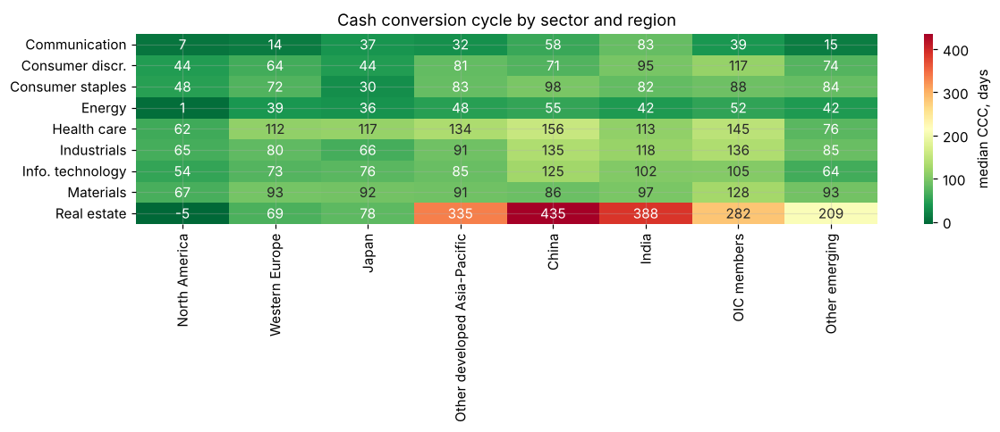
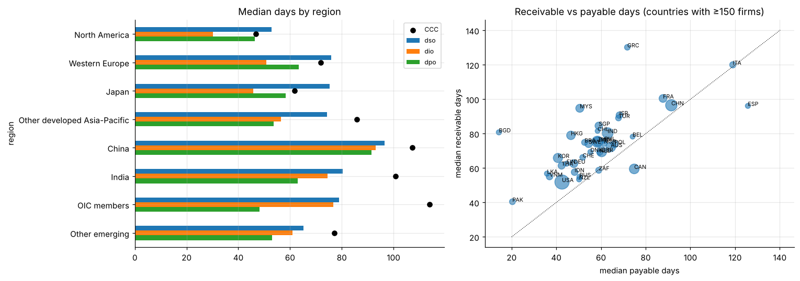
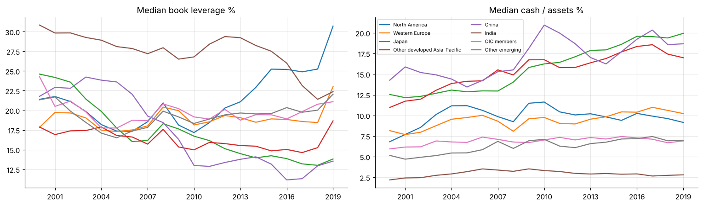
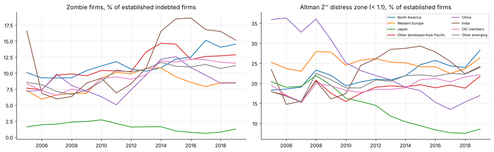
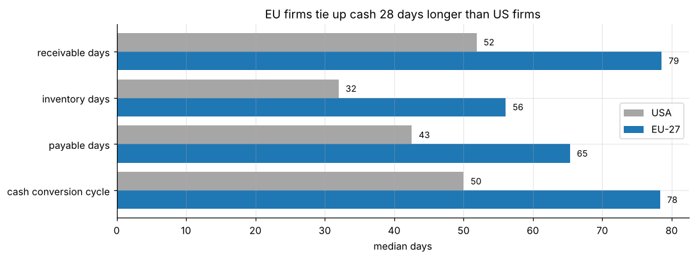
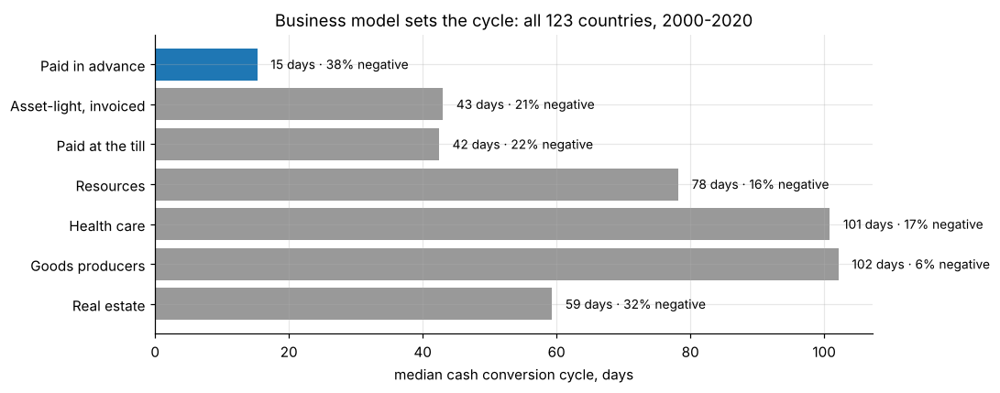

# Global Firm Financials: 53,000 companies, 123 countries, 2000-2020

A cross-country corporate-finance study built from **Compustat Global and Compustat North America**: working capital, capital structure, cash, trade credit, financial distress, zombie firms, valuation and investment. It covers 607,799 firm-years of non-financial companies. Every result is estimated on the full firm-level panel and reported as country, region or regression aggregates.



## Key results

| Question | Answer |
|---|---|
| Where is cash tied up longest in working capital? | Median cash conversion cycle of **47 days in North America**, 62 in Japan, 72 in Western Europe, ~100 in India and China and **114 in OIC countries**. The gap comes from inventory and thin supplier credit |
| Does a shorter cycle mean higher profits? | Yes, within firms: 100 more receivable days cost 0.2-0.7 points of ROA in every region, but the effect is modest |
| Who borrows, who hoards cash? | Indian firms: 27% leverage, 3% cash. Japan and China deleveraged by ~10 points since 2000 while US leverage rose to 31% (including the 2019 lease-accounting change). Cash rises with national income (ρ = 0.52) |
| Do textbook leverage determinants hold everywhere? | Yes within firms: tangibility raises and profitability lowers leverage in all eight regions (t > 10) |
| What drives trade credit (PhD design)? | Trade credit received is passed on (β = 0.24, 0.35 in OIC countries). Cash, growth and intangibles reduce it, and fixed effects are required in every group |
| How common are zombie firms? | 12% of established indebted firms in North America and India, 8% in Europe, 1.6% in Japan. Rising since 2008, and only a quarter to a third recover within three years |
| Do US firms invest on Q or cash flow? | On Q (t = 10.6). Cash-flow sensitivity is zero or negative, so the classic financing-constraint signal is gone |
| USA vs EU: how much cash is tied up? | EU median cycle 78 days vs 50 in the US (UK 51). Collecting at US speeds would release about **USD 450 billion** in EU receivables (2019, excluding carmakers' finance receivables), mostly in France and Germany |
| Do services run on customer money? | Telecoms, hotels, restaurants, education and media run 15-day cycles and 38% are negative. Goods producers need ~100 days. But outside services, a negative cycle usually marks a loss-making firm stretching suppliers (ROA 20-28 points below peers) |
| Are country gaps sector mix or behaviour? | Behaviour: within-industry differences explain a median 78% of each country's gap to the US |
| Where does return on equity come from? | Margins in emerging markets (China 7.2% net margin, 0.6x turnover), turnover and debt in rich ones. Asset turnover fell almost everywhere since 2008 |
| Can machine learning predict distress? | Yes: gradient boosting ranks next-year interest-cover failures with AUC 0.83 out of sample (Altman Z'' 0.59), and its riskiest decile holds 38% of failures |
| Does the Beneish M-score work outside the US? | It flags 4.5% of firm-years in Japan and 27% in India, and flagged firms lose 1.8 more ROA points and are 4 points likelier to report a loss two years later |
| Are costs sticky? | Everywhere: SG&A rises 0.49% per 1% sales rise in North America but falls only 0.37% per 1% fall; China is the stickiest |
| Are markups and concentration rising? | Sales-weighted markups rose in North America, Europe, Japan and India; US telecoms (+32 pts top-4 share) and tech hardware (+16) concentrated most |
| How many firms are Shariah-compliant? | 47% pass an asset-based screen, 38% in North America to 55% in emerging markets. Compliant firms are more profitable and safer, and US compliant stocks beat others by 13 pts in 2008 |
| What protected firms in 2020? | Cash: top-quartile cash holders grew 2020 sales by 1%, the bottom quartile lost 5% |

<p float="left">
  
  
  
  
  
</p>

## Notebooks

| # | Notebook | Methods |
|---|---|---|
| 1 | [Sample and coverage](notebooks/01_sample_and_coverage.ipynb) | Combining two Compustat databases, de-duplication, filters, USD conversion, coverage by country and year |
| 2 | [Working capital around the world](notebooks/02_working_capital_around_the_world.ipynb) | DSO, DIO, DPO and CCC by country, region and sector; trends; same-firm crisis changes; firm-FE profitability regressions |
| 3 | [Capital structure and cash](notebooks/03_capital_structure_and_cash.ipynb) | Rajan-Zingales leverage and Opler et al. cash models with firm and year FE, by region; cross-country patterns |
| 4 | [Trade credit determinants](notebooks/04_trade_credit_determinants.ipynb) | PhD design on all countries; FE vs pooled; robust Mundlak-Hausman test; 2008-09 crisis by cash tercile |
| 5 | [Distress and zombie firms](notebooks/05_distress_and_zombie_firms.ipynb) | Altman Z'' (1995), zombie definitions (broad vs established), country rankings, transition outcomes |
| 6 | [North America: market values](notebooks/06_north_america_market_based_analysis.ipynb) | Tobin's Q, market leverage, original Altman Z, investment-Q-cash flow regressions, US vs Canada |
| 7 | [USA vs EU](notebooks/07_usa_vs_eu.ipynb) | Working capital, profitability, leverage and zombies for US, EU-27 and UK; EU country ranking; cash-release estimate; FE regressions by bloc |
| 8 | [Sector business models worldwide](notebooks/08_sector_business_models_worldwide.ipynb) | Cycles by industry and region, no-inventory and negative-cycle firms, shift-share of country gaps, trends, and the profitability of negative-cycle firms |
| 9 | [Performance: DuPont, persistence, growth, productivity](notebooks/09_performance_dupont_growth_productivity.ipynb) | ROE decomposition by region and industry, profit persistence and quintile transitions, high-growth firms, sales per employee |
| 10 | [Markups and concentration](notebooks/10_markups_and_concentration.ipynb) | Sales/COGS markups, within vs reallocation decomposition, top-4 sales and top-10% profit shares, concentration and ROA |
| 11 | [Earnings quality, Beneish, cost stickiness, tax](notebooks/11_earnings_quality_beneish_stickiness_tax.ipynb) | Sloan accruals, modified Jones discretionary accruals by country, Beneish M-score with validation, SG&A stickiness, effective tax rates |
| 12 | [Distress prediction with ML, and COVID-19](notebooks/12_distress_prediction_ml_and_covid.ipynb) | Logistic regression and gradient boosting vs Altman Z'', calibration, feature importance; 2019 traits that predicted 2020 resilience |
| 13 | [North America: factor portfolios and payout](notebooks/13_north_america_factors_and_payout.ipynb) | Value, profitability, investment, size and leverage quintile portfolios; dividend payers and Lintner smoothing in the US and Canada |
| 14 | [Shariah screening worldwide](notebooks/14_shariah_screening_worldwide.ipynb) | Asset-based Shariah screens by country, which screen binds, performance and crisis behaviour of compliant firms, US stock returns |

**Peer benchmark tool:** [drimranbhatti.github.io/global-firm-financials](https://drimranbhatti.github.io/global-firm-financials/). Enter your ratios and see your percentile among listed peers in 49 markets and 20 industries (aggregate percentiles only; built by `scripts/build_benchmark.py`).

## Data and licensing
Compustat is licensed by S&P Global Market Intelligence through WRDS, and **firm-level data cannot be redistributed**. This repository therefore contains:

* the **code** that builds the panel from your own Compustat extract (`scripts/reduce_compustat.py`, `scripts/build_panel.py`);
* **aggregate results only** in `data/`: country medians, country-year working-capital medians and regression coefficients. Cells with fewer than 20 firms are suppressed;
* public World Bank exchange rates and GDP per capita.

The notebooks were executed on the full private panel. To reproduce them, export `comp.g_funda` and `comp.funda` (annual, 2000 onwards) from WRDS and run:

```bash
pip install -e ".[notebooks,dev]"
pytest                                                       # 5 tests on synthetic data
python scripts/reduce_compustat.py GLOBAL.csv NORTH_AMERICA.zip private/
python scripts/build_panel.py --global private/global_annual.parquet --na private/na_annual.parquet --out private/panel.parquet
jupyter lab notebooks/
```

## Package
`src/firmpanel/`: `clean` (database combination, filters, FX conversion, winsorising) · `ratios` (working-capital days, leverage, cash, tangibility, trade credit, Altman Z'', zombie flags) · `aggregate` (publishable summaries with minimum cell sizes, region mapping) · `regress` (two-way fixed effects with firm-clustered errors)

## Definitions
Receivable days = 365 × receivables / sales; inventory days = 365 × inventory / COGS; payable days = 365 × payables / COGS. Leverage = (long-term + short-term debt) / assets. ROA = operating income after depreciation / assets. All ratios are winsorised at 1%/99% within each year. Financials (GICS 40) and utilities (GICS 55) are excluded.

## References
Rajan & Zingales (1995) · Opler, Pinkowitz, Stulz & Williamson (1999) · Deloof (2003) · Love, Preve & Sarria-Allende (2007) · Altman (1968, 1995) · Fazzari, Hubbard & Petersen (1988) · Chen & Chen (2012) · Banerjee & Hofmann, BIS Quarterly Review (2018)

---
**Author:** Dr. Muhammad Imran Bhatti, PhD (Finance), MScFE · FCMA · [LinkedIn](https://www.linkedin.com/in/drimranbhatti) · [imranbhatti.com](https://imranbhatti.com)

*Extends the firm-level methodology of my PhD research (trade credit and working capital in OIC countries) to the full Compustat universe. Available for firm-level and cross-country financial analysis, credit-risk screening and research collaboration. Research only; not investment advice. Code MIT licensed; Compustat data © S&P Global, not included.*
